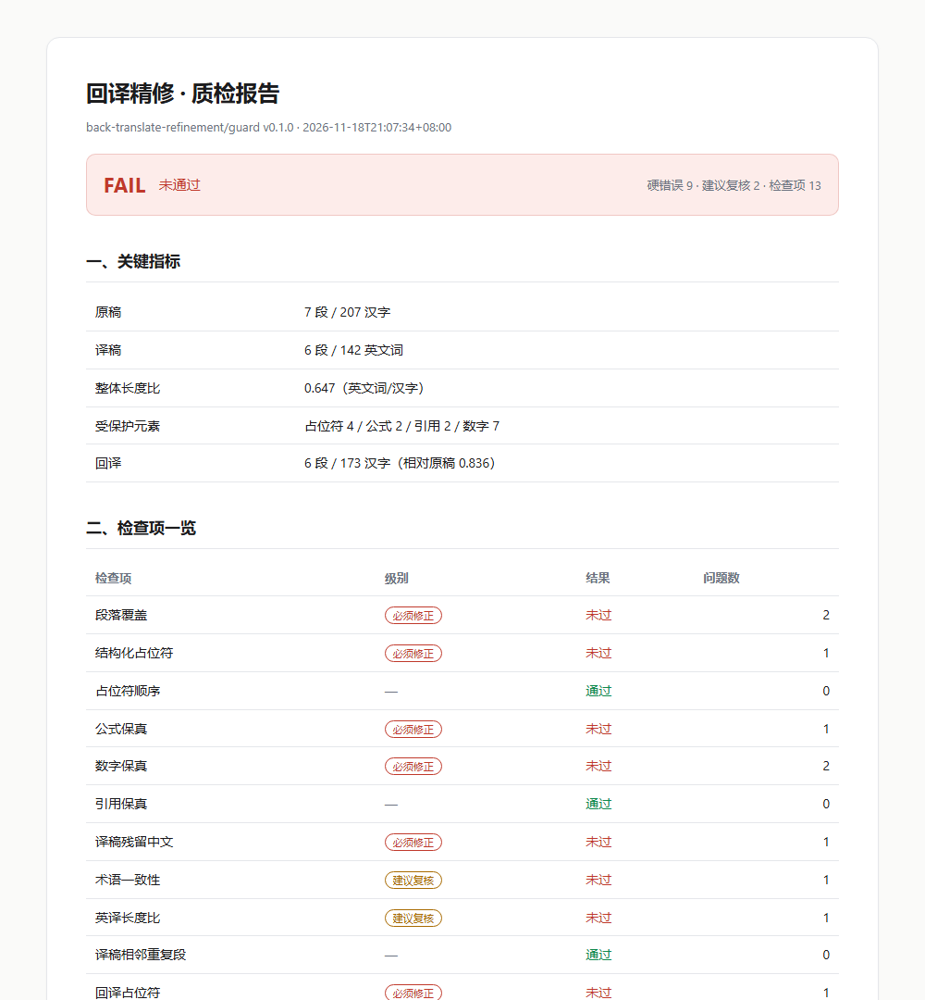

# back-translate-refinement

English | [简体中文](README.md)

[](https://github.com/GongfaChen/back-translate-refinement/actions/workflows/ci.yml)
[](https://github.com/GongfaChen/back-translate-refinement/releases)
[](LICENSE)
[](requirements.txt)

**Agent skill: translate Chinese manuscripts into English with *strictly
consistent* semantics — back-translation comparison + deterministic fidelity
gates + a forwardable QA report.**

Not "yet another translation tool". Translation quality doesn't come from a
bigger model; it comes from **making the loss visible**:

```text
ZH source ──translate──▶ EN draft ──back-translate (blind)──▶ ZH back-translation
                                                                  │
                ZH source ◀──────── paragraph-wise compare ───────┘
                     │
                     ▼
        missing / added / distorted / term drift → fix EN → back-translate again → loop
```

The toolchain automates every **mechanically checkable** part of that loop.
(LLMs are unreliable at counting numbers, counting structure, and staying
consistent — exactly the hard errors reviewers pick on first.)

> Companion repo: **[pdf-to-pptx-omml](https://github.com/GongfaChen/pdf-to-pptx-omml)**
> — PDF textbook chapters → slides with editable equations. Together they cover
> translate-then-teach pipelines for Chinese course material.

## Demo

`demo/` contains a 7-paragraph sample with **6 classes of planted defects**
(a missing paragraph, dropped table placeholder, dropped equation, `12M`
turned into `21M`, leftover Chinese, terminology drift). The gate catches all
of them and produces a forwardable QA report:



```bash
cd demo && python smoke_test.py     # reproduce: run the sample, assert all 6 defect classes are caught
```

## Real case: a submitted paper, CN → EN

`demo/real-case/` holds a **real artifact**: a bridge-monitoring paper
(two-stage hanger-force anomaly identification), desensitised, with both the
raw MT draft and the refined version.

**Full-paper scope** (359 units):

| Metric | Value |
|---|---|
| Units changed by refinement | 42 (11.7%) |
| Number tokens / citation tokens | 882 / 28 |
| Fact-level changes (draft → refined) | **0** — numbers, citations, `Eq.` numbers byte-identical, recomputed block-by-block |
| Fidelity gate | 10/10 PASS |

```bash
cd demo/real-case && python run_real_case.py    # gate + drift check + edit classification, ~1 s
```

One disclosure worth reading: the refined draft originally spelled out
`Fifteen` where the source had `15`, and **the gate flagged it immediately**.
The fix wasn't a blind digit swap (English sentences shouldn't open with a
numeral) — the number was moved into the clause instead. The gate surfaces
suspects; wording is still the human's call. See
[`demo/real-case/README.md`](demo/real-case/README.md).

## Core components

| File | Purpose |
|---|---|
| `SKILL.md` | Agent workflow: translate → back-translate (blind) → hard gates → semantic compare → fix → deliver |
| `scripts/bt_probe.py` | **Free diagnosis** (read-only): size, protected elements, batching advice, risks (docx formula loss, etc.) |
| `scripts/glossary.py` | Terminology extraction (CJK n-grams + inline `中文（English）` pairs) + glossary self-validation |
| `scripts/guard.py` | **Deterministic fidelity gate** (the core asset): placeholders / placeholder order / equations verbatim / numbers / citations / paragraph coverage / leftover Chinese / glossary consistency / length anomalies / adjacent duplicates — **10 checks**, +3 back-translation checks with `--back` |
| `scripts/report.py` | Renders guard JSON into a forwardable QA report (Markdown + single-file HTML, with input sha256 and repro commands) |
| `references/pitfalls.md` | 30 field-tested pitfalls — the most compounding asset in this repo |

## Quick start

```bash
git clone git@github.com:GongfaChen/back-translate-refinement.git
cd back-translate-refinement
pip install -r requirements.txt

python scripts/check_env.py                 # read-only environment gate
python scripts/bt_probe.py your_source.md   # free diagnosis
python scripts/glossary.py extract --source your_source.md --out terms.csv
# produce the EN draft and the blind back-translation (SKILL.md Steps 2–3), then:
python scripts/guard.py --source source.md --translation draft.md \
  --back back.md --glossary terms.csv --json out.json
python scripts/report.py out.json           # forwardable QA report
```

Exit codes: `0` PASS | `1` WARN | `2` FAIL — drop it straight into CI.

## Design principles

1. **Scripts judge mechanical items, models judge semantics** — the division of
   labor is written into SKILL.md; delivery requires passing both.
2. **Paragraph numbers are anchors** — segmentation must be deterministic;
   guard checks it first, because every comparison breaks without it.
3. **Back-translation must be blind** — if the model can "remember" the source,
   losses get quietly patched back and comparison becomes meaningless.
4. **Reports are reproducible** — input sha256 + full command; same input,
   same verdict.
5. **Reports state their limits** — all-mechanical-pass ≠ semantics intact;
   the report explicitly says what it cannot prove.

## Known limits

- Semantic consistency (missing/added/distorted) cannot be judged by scripts —
  that's SKILL.md Step 5's job, and the report says so.
- Author–year citations, scientific notation (`1e-4`), and other non-verbatim
  equivalent forms escape mechanical checks; glossary + human review cover them.
- Length-ratio thresholds are calibrated for **ZH→EN**; other language pairs
  need the band adjusted (see README.md 中文版 for values).

## License

MIT (screenshots under `assets/` are self-produced demos, no third-party
copyrighted content).
