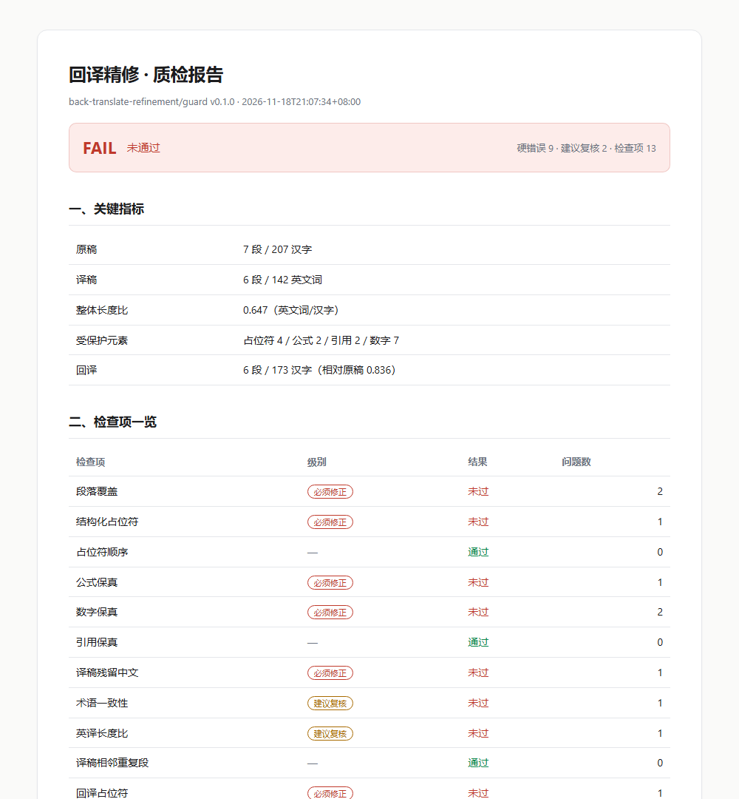

# back-translate-refinement

[](https://github.com/GongfaChen/back-translate-refinement/actions/workflows/ci.yml)
[](https://github.com/GongfaChen/back-translate-refinement/releases)
[](LICENSE)
[](requirements.txt)
[]()

**Agent skill：把中文稿件翻译成"语义严格一致"的英文——回译比对 + 确定性保真闸 + 可转发的质检报告。**

不是"又一个翻译工具"。翻译质量不是靠模型更大，而是靠**让损耗可见**：

```text
中文原稿 ──正译──▶ 英文译稿 ──回译（盲）──▶ 中文回译稿
                                                │
                中文原稿 ◀────── 逐段比对 ──────┘
                     │
                     ▼
        缺失 / 添加 / 扭曲 / 术语漂移 → 修英文 → 再回译 → 循环
```

工具链把循环里**机械可判**的部分全部自动化（LLM 数数字不可靠、数结构不可靠、保一致不可靠——这三类恰是审稿人最先挑的硬错误）。

## 效果演示

`demo/` 里有一份 7 段样稿，**故意植入 6 类典型缺陷**（漏一段、丢表格占位、丢公式、12M 写成 21M、残留中文、术语漂移）。guard 全部抓到，并生成可转发的质检报告：



```bash
cd demo && python smoke_test.py     # 复现：跑样稿、断言 6 类缺陷全被抓住
```

## 核心组件

| 文件 | 作用 |
|---|---|
| `SKILL.md` | Agent 工作流：正译 → 回译（盲）→ 硬闸 → 语义比对 → 修正 → 交付 |
| `scripts/bt_probe.py` | **免费诊断**（只读）：规模、受保护元素统计、分批建议、风险清单（docx 公式丢失等） |
| `scripts/glossary.py` | 术语抽取（CJK n-gram + 原文自带「中文（English）」对照）+ 术语表自身校验 |
| `scripts/guard.py` | **确定性保真闸**（核心资产）：占位符 / 占位符顺序 / 公式逐字 / 数字 / 引用 / 段落覆盖 / 残留中文 / 术语一致性 / 长度异常 / 相邻重复 / 回译往返，共 10+ 项 |
| `scripts/report.py` | 把 guard JSON 渲染成可转发的质检报告（Markdown + 单文件 HTML，含输入 sha256 与复现命令） |
| `scripts/license_check.py` | 许可钩子：纯 Python Ed25519（与 pdf-to-pptx-omml 共用同一套后端），当前全免费放行 |
| `references/pitfalls.md` | 30 条实战坑（本仓库最重要的复利资产） |
| `references/fidelity-rubric.md` | 语义四分类判定标准 + 迭代终止条件 |
| `references/structured-preservation.md` | 占位符规范：内联 / 整块两种约定 + docx/LaTeX 识别要点 |

## 快速开始

```bash
git clone git@github.com:GongfaChen/back-translate-refinement.git
cd back-translate-refinement
pip install -r requirements.txt        # python-docx 仅处理 .docx 时需要

python scripts/check_env.py                             # 环境闸（只读）
python scripts/bt_probe.py 你的原稿.md                   # 免费诊断
python scripts/glossary.py extract --source 你的原稿.md --out terms.csv   # 术语候选
# 按 SKILL.md Step 2–3 产出正译稿与回译稿（回译必须盲）后：
python scripts/guard.py --source 原稿.md --translation 译稿.md \
  --back 回译稿.md --glossary terms.csv --json out.json  # 确定性保真闸
python scripts/report.py out.json                        # 可转发质检报告
```

退出码：`0` PASS｜`1` WARN｜`2` FAIL——适合直接嵌进 CI 或批量流水线。

## 设计原则

1. **脚本判机械项，模型判语义**——分工写在 SKILL.md 里，两层都过才算交付。
2. **段号即锚点**——分段必须确定性；段数对不上，一切比对失效，guard 第一项就查它。
3. **回译必须盲**——模型若能"记住"原稿，损耗会被悄悄补上，比对失去意义。
4. **报告可复现**——输入 sha256 + 完整命令，同一输入必然得到同一结论。
5. **报告明确边界**——机械项全对 ≠ 语义没走样；报告第七节专讲"本报告不能证明什么"。

## 验证状态

- `bt_common` 自检：token 抽取顺序、公式内数字不重复计数、全角归一、分段确定性
- `license_check --self-test`：RFC 8032 官方向量 + 篡改/过期/越权/免费模式/小阶公钥拒绝
- `check_env`：Python 版本、依赖矩阵、6 模块 import、Ed25519 签名往返
- demo 端到端：7 段样稿（6 类植入缺陷）→ guard 报 9 error / 2 warn，逐条与植入缺陷一一对应 → report.py 产出 MD + HTML
- CI：GitHub Actions（Ubuntu × Python 3.12/3.13）

## 已知限制

- 语义一致性（缺失/添加/扭曲）无法由脚本判定——那是 SKILL.md Step 5 的工作，报告会明确声明这一点
- 作者-年份引用、科学计数法（1e-4）等非逐字等价形态，机械检查抓不住，靠术语表 + 人工
- 英文→中文方向未系统测试：占位符与分段机制方向无关，但长度比阈值是按"英译中"标定的
- `1e-4`、`v2.0` 这类含字母数字混合 token 的比较规则偏保守（宁可放过，不可误报）

## Roadmap

- [x] v0.1 开源核心：probe + 术语抽取 + 10 项确定性保真闸 + 可转发报告 + 30 条坑
- [ ] 批量文档模式（整本处理，断点续跑）
- [ ] docx 公式内容级校验（OMML → LaTeX 归一比较）
- [ ] Markdown 语法标记多重集检查（加粗/链接/代码块）
- [ ] 与 pdf-to-pptx-omml 联动：教材 PDF → 英文讲义 → 公式可编辑 PPT 全链路

## License

MIT（`assets/` 下截图为自产演示，无第三方版权内容）
